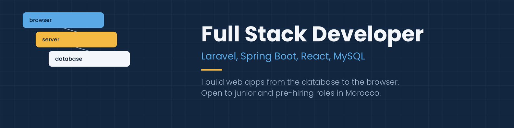
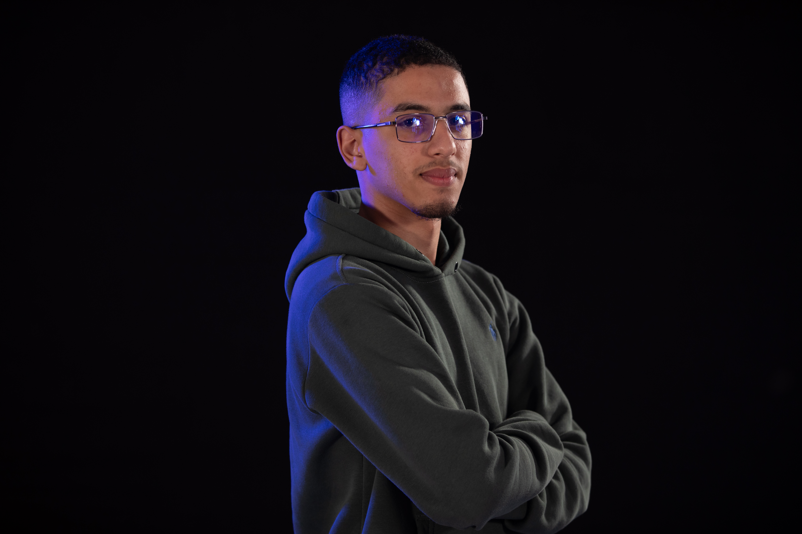

  

<h1 align="center">
    
</h1>

<h3 align="center">A passionate full stack developer from Morocco 🇲🇦</h3>

  

 

🔭 I build web apps **from the database to the browser**

🌱 I'm currently open to **junior and pre-hiring roles in Morocco**

💬 Ask me about **Laravel, Spring Boot, React, MySQL... or anything [here](https://github.com/YOUR-USERNAME/YOUR-USERNAME/issues)**

 

  
  
  <!-- 🌐 PORTFOLIO: uncomment this block once your portfolio is ready and replace the link
  
  -->

 

<h2 align="center">⚒️ Languages, Frameworks & Tools ⚒️</h2>
 

     
     
     
     

 

  <h2>🐍 My Contributions 🐍</h2>
   
  

     

<h2 align="center">⚡ Stats ⚡</h2>
 

  
  
   
  

  

 

  

 
"# oldm2563-blip" 
"# oldm2563-blip" 
"# oldm2563-blip" 
"# oldm2563-blip" 
